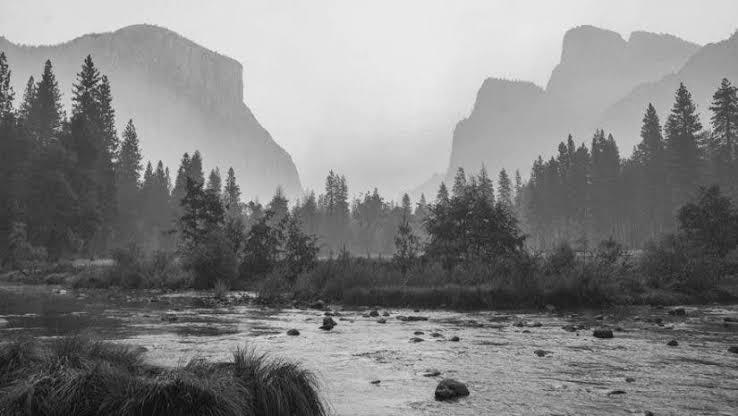
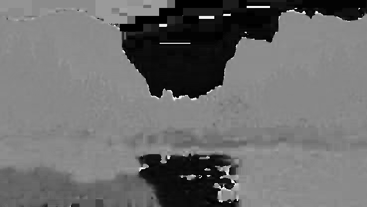
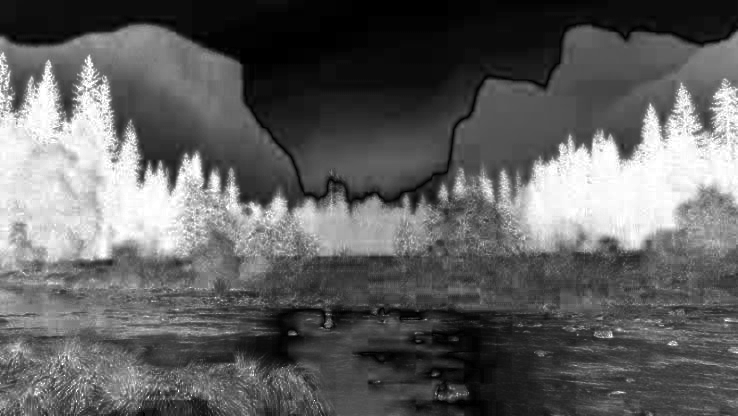
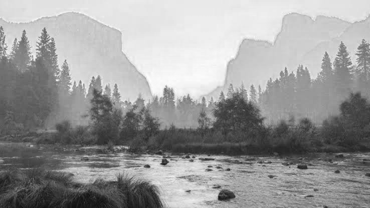
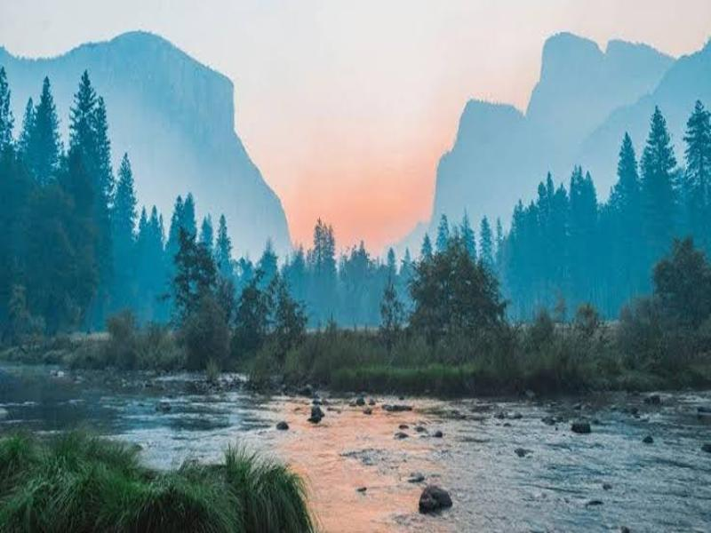
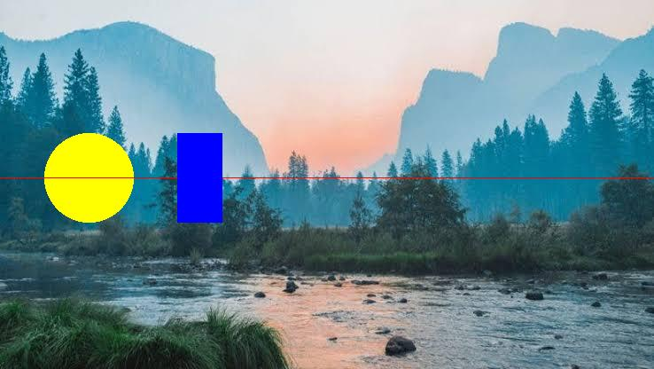

# Lab 1 – Basic Image Processing

## 1. OVERVIEW

This lab introduces fundamental image processing operations using Python and the Pillow library.

The exercises cover image loading, color space conversion, cropping, resizing, drawing basic shapes and adding text to images.

## 2. REQUIREMENTS

- Python 3.x
- Pillow
- Jupyter Notebook

Install the required libraries:

```bash
pip install pillow jupyter
```

## 3. PROJECT STRUCTURE

```text
Lab1/
├── assets/
│   └── fonts/
│       └── DejaVuSans.ttf
├── docs/
│   ├── plan.md
│   └── implementation.md
├── outputs/
├── images.jpg
├── Lab1.ipynb
└── README.md
```

## 4. IMPLEMENTED FEATURES

| No. | Feature | Description |
|---|---|---|
| 1 | Image Loading | Read and save images |
| 2 | Color Conversion | Grayscale, HSV and LAB |
| 3 | Cropping | Extract a specific image region |
| 4 | Resizing | Change image dimensions |
| 5 | Drawing | Draw circles, lines and rectangles |
| 6 | Text Annotation | Add text to images |

## 5. HOW TO RUN

Clone the repository:

```bash
git clone https://github.com/duytruong849/Lab-Computer-Vision.git
```

Open the project directory:

```bash
cd Lab-Computer-Vision/Lab1
```

Install dependencies:

```bash
pip install pillow jupyter
```

Launch Jupyter Notebook:

```bash
jupyter notebook Lab1.ipynb
```

Run the notebook cells in order.

## 6. OUTPUTS

All generated images are stored in the `outputs/` directory.

### 6.1. Grayscale Conversion



### 6.2. HSV Color Space

| Hue (H) | Saturation (S) | Value (V) |
|---|---|---|
|  |  |  |

### 6.3. LAB Color Space

[View LAB output](outputs/images_LAB.tif)

### 6.4. Cropping and Resizing

| Cropped Image | Resized Image |
|---|---|
|  |  |

### 6.5. Drawing and Text Annotation

| Drawing Shapes | Adding Text |
|---|---|
|  |  |

## 7. DOCUMENTATION

- [Plan](docs/plan.md)
- [Implementation](docs/implementation.md)

#